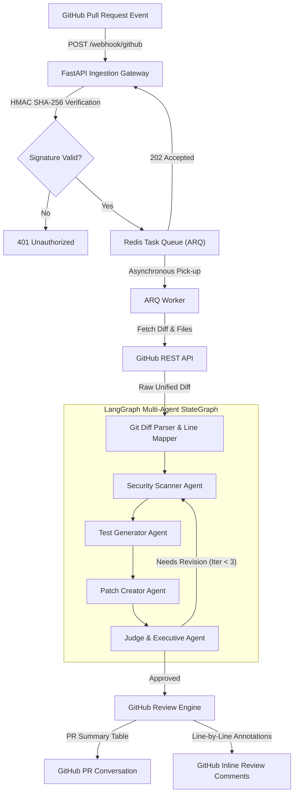

# CodeSentinel 🛡️
> **Autonomous Multi-Agent GitHub Pull Request & Security Review System**  
> *Built with LangGraph, FastAPI, Redis ARQ, Docker, and PyGitHub.*

[](https://github.com/ensibey/CodeSentinel/actions)
[](https://www.python.org/downloads/)
[](https://fastapi.tiangolo.com)
[](https://redis.io)
[](https://opensource.org/licenses/MIT)

---

## 🎯 Executive Overview

**CodeSentinel** is an event-driven, production-grade autonomous AI code reviewer designed for modern engineering teams. When a Pull Request is opened or updated on GitHub, CodeSentinel:
1. **Verifies Cryptographic HMAC Signatures** to prevent unauthorized spoofing.
2. **Offloads Heavy Workloads** to an asynchronous Redis ARQ task queue in under 50ms.
3. **Parses Unified Git Diffs** to reconstruct line mapping and AST context.
4. **Deploys a Cyclical Multi-Agent Team (LangGraph)**:
   - 🔍 **Security Scanner Agent**: Static AST analysis + LLM audit for OWASP Top 10 vulnerabilities (SQLi, Secrets, Path Traversal, Insecure Deserialization).
   - 🧪 **Test Generator Agent**: Synthesizes isolated, executable `pytest` test suites for changed logic.
   - 🩹 **Patch Creator Agent**: Generates unified diff patches proposing clean remediations.
   - ⚖️ **Judge & Executive Agent**: Evaluates hallucinations and code regressions with iterative self-correction.
5. **Posts Production-Quality Feedback**:
   - High-level markdown summary review comments on the PR discussion thread.
   - Exact line-by-line inline code review comments.

---

## 🏗️ Architecture & Event Flow



---

## 📂 Project Structure

```
codesentinel/
├── .github/
│   └── workflows/
│       └── ci.yml               # Automated GitHub Actions test pipeline
├── docker/
│   ├── Dockerfile               # Container definition for API & Worker
│   └── docker-compose.yml       # One-command orchestration (Redis + API + Worker)
├── docs/
│   └── sequence_diagram.md      # Detailed event sequence diagram
├── src/
│   ├── config.py                # Type-safe Pydantic Settings & environment
│   ├── api/
│   │   ├── main.py              # FastAPI application & lifespan management
│   │   └── webhooks.py          # GitHub Webhook listener & HMAC validation
│   ├── queue/
│   │   └── worker.py            # ARQ Redis background worker & task runner
│   ├── github_client/
│   │   ├── client.py            # Async GitHub REST API client
│   │   └── parser.py            # Unified git diff chunker & line number mapper
│   └── agents/
│       ├── state.py             # LangGraph shared AgentState & Pydantic models
│       ├── graph.py             # Cyclic StateGraph workflow compiler
│       ├── security_scanner.py  # Agent 1: Vulnerability detection
│       ├── test_generator.py    # Agent 2: Pytest generation
│       ├── patch_creator.py     # Agent 3: Patch synthesis
│       └── judge.py             # Agent 4: Self-correction & quality gate
├── tests/
│   ├── conftest.py              # Test fixtures & signature helpers
│   ├── test_config.py           # Configuration tests
│   ├── test_diff_parser.py      # Git diff parsing tests
│   ├── test_github_client.py    # GitHub API client unit tests
│   ├── test_webhook.py          # Webhook HMAC & ingestion integration tests
│   └── test_worker.py           # Background worker execution tests
├── .env.example                 # Environment variables blueprint
├── pyproject.toml               # Modern Python package configuration
└── requirements.txt             # Pinned project dependencies
```

---

## 🚀 Getting Started

### Prerequisites
- Python 3.10+
- Redis 7+ (or Docker)
- Git

### 1. Clone & Set Up Virtual Environment

```bash
git clone https://github.com/ensibey/CodeSentinel.git
cd CodeSentinel

python -m venv .venv
source .venv/bin/activate  # On Windows: .venv\Scripts\activate
pip install -r requirements.txt
```

### 2. Environment Configuration

Copy `.env.example` to `.env` and fill in your keys:

```bash
cp .env.example .env
```

Key variables:
- `GITHUB_TOKEN`: GitHub Personal Access Token (`repo` scope).
- `GITHUB_WEBHOOK_SECRET`: Secret key entered into GitHub repository webhook settings.
- `REDIS_HOST` & `REDIS_PORT`: Redis connection details.

### 3. Run with Docker Compose (Recommended)

To start the API, background worker, and Redis queue in a single command:

```bash
docker compose -f docker/docker-compose.yml up --build
```

### 4. Run Locally (Development Mode)

Start the Redis server, then run:

```bash
# Terminal 1: FastAPI Ingestion Gateway
uvicorn src.api.main:app --host 0.0.0.0 --port 8000 --reload

# Terminal 2: ARQ Task Worker
python -m src.queue.worker
```

Open interactive Swagger documentation at `http://localhost:8000/docs`.

### 5. Run Live Local Demo Simulation

Experience CodeSentinel's multi-agent workflow instantly on a simulated vulnerable PR without setting up external webhooks:

```bash
python scripts/simulate_pr_event.py
```

---

## 🧪 Testing

Run the comprehensive automated test suite with pytest:

```bash
pytest -v
```

---

## 🔐 Webhook Security & Verification

CodeSentinel rigorously enforces GitHub's security standard:
- Validates the `X-Hub-Signature-256` header against the payload using HMAC SHA-256 and timing-attack-safe comparison (`hmac.compare_digest`).
- Validates delivery uniqueness and rejects malformed JSON payloads with descriptive HTTP status codes.

---

## 🗺️ Roadmap & Implementation Phases

- [x] **Phase 1: Ingestion Infrastructure & Webhook Gateway**
  - FastAPI `/webhook/github` endpoint with HMAC SHA-256 validation.
  - Redis ARQ task queue with asynchronous worker.
  - PyGitHub / HTTP client for PR diff and file tree retrieval.
  - Unified diff parser with line-accurate mapping.
- [x] **Phase 2: LangGraph Multi-Agent Architecture**
  - Cyclic StateGraph with AST static analysis and vulnerability scanner.
  - Automated pytest synthesis and patch generator.
  - Judge agent with self-correction feedback loop (`iteration_count < 3`).
  - LangSmith tracing integration.
- [x] **Phase 3: GitHub Live PR Feedback Engine**
  - PR summary scorecard markdown table (`POST /repos/{owner}/{repo}/pulls/{number}/reviews`).
  - Line-by-line inline code review comments with diff hunk boundary protection.
  - Fallback issue comment and individual reviews on API restriction.
  - GitHub App JWT RS256 authentication and PAT support.
- [x] **Phase 4: Production Polish & Showcase**
  - Docker & Docker Compose (`docker-compose.yml`) multi-service orchestration.
  - Local terminal simulator script with Rich styling (`scripts/simulate_pr_event.py`).
  - Automated GitHub Actions CI pipeline (`.github/workflows/ci.yml`).

