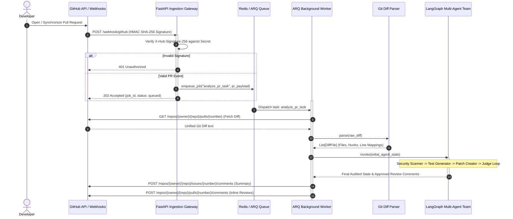

# CodeSentinel Event Flow & Sequence Diagram

This document illustrates the end-to-end execution flow of CodeSentinel from the moment a GitHub Pull Request is created or synchronized to the asynchronous multi-agent audit and automated PR commentary.

